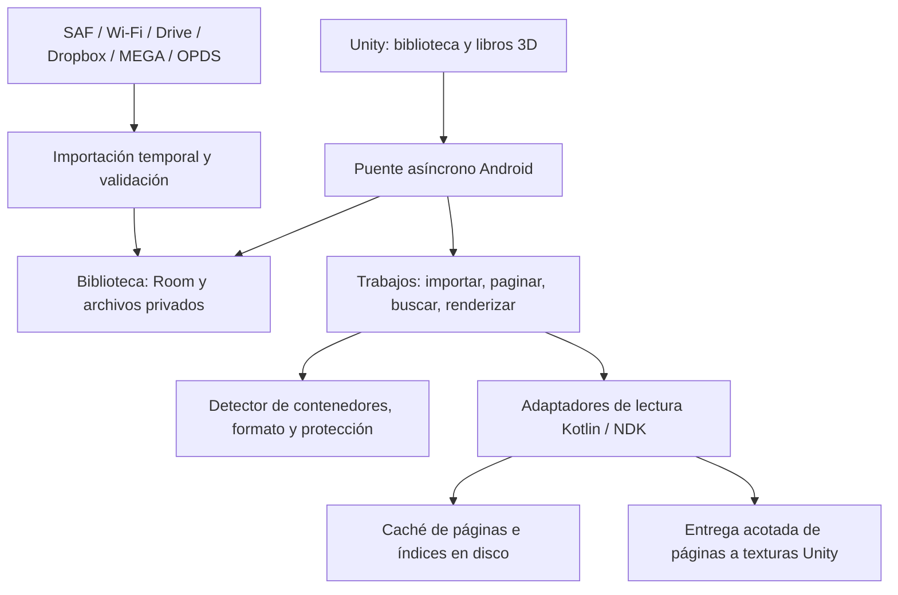

# Arquitectura propuesta de Folio XR

Estado: diseño de Fase 0, 5 de noviembre de 2026. Los nombres de módulos y operaciones de este documento son contratos propios propuestos, **no APIs existentes de Meta, Unity o Readium**. Todavía no están implementados.

## Elección de plataforma

Se elige Unity LTS con Meta XR SDK para interacción y passthrough, acompañado de un módulo Android Kotlin y bibliotecas nativas C/C++ vía NDK. La prioridad es un libro 3D personalizable: geometría de páginas, agarre, movimiento, cambio de página, iluminación y texto legible a corta distancia. Se mantiene Meta Spatial SDK como alternativa evaluada, sin mantener dos aplicaciones simultáneas.

| Criterio | Unity LTS + Meta XR + Android | Meta Spatial SDK (Kotlin) |
| --- | --- | --- |
| Libro 3D | Motor de mallas, materiales y animación apropiado para deformación de páginas; interacción física y manos mediante SDK, con ajuste propio | Entidades/escena y paneles Android útiles; un libro con páginas deformables y render personalizado requiere comprobar capacidades concretas |
| Integración de lectores | Kotlin/NDK mediante puente y AAR; el paso de una página a una textura añade complejidad | Acceso más directo al ecosistema Android; una vista de lectura plana sigue sin resolver por sí sola el libro físico |
| Archivos gigantes | El backend y sus límites determinan el consumo; Unity no aporta streaming de documentos automáticamente | Mismo problema de parsers, índices y cachés; Kotlin no garantiza menor memoria por sí solo |
| Linux/Pop!_OS | Unity ofrece herramientas para Linux; comprobar distribución oficialmente soportada, GPU y versión del Editor | Los ejemplos oficiales consultados requieren Mac o Windows y Spatial Editor en muchos casos; Linux no se da por soportado |
| Riesgo principal | Integración gráficos/EPUB/Android y compatibilidad exacta de paquetes | Fidelidad de interacción/páginas y cadena de herramientas compatible con el PC del usuario |

La combinación exacta de Editor LTS, Meta XR, proveedor OpenXR, Android Gradle Plugin, JDK, SDK/NDK y backend gráfico se fijará al inicio de Fase 1 con un build mínimo real. No se inventa una pareja de versiones “compatible” por mezclar las últimas disponibles. Las versiones de los ejemplos de Spatial SDK no se trasladan al proyecto Unity.

Unity está sujeto a los términos de licencia del Editor y a los criterios vigentes de sus planes; no es un motor de código abierto bajo BSD/MIT. Los paquetes Meta tienen sus propios términos; el SDK Spatial usa la licencia Meta Platform Technologies. La licencia de un ejemplo no sustituye la del SDK. Registrar términos y avisos de cada versión antes de distribuir, junto al inventario de bibliotecas del documento de formatos.

Passthrough como fondo no requiere que la app capture los fotogramas de las cámaras. No añadir la Passthrough Camera API ni permisos de acceso a imágenes de cámaras para ese requisito. Los ejemplos oficiales First Hand demuestran Interaction SDK, manos, mandos y una escena MR; se usan como referencia de capacidades, no como una matriz vigente de versiones para copiar.

## Componentes y flujo



Unity es responsable del espacio, interacción, libro 3D, estantería, paneles, posturas y presentación de errores. Android es responsable de archivos, conectores, credenciales, detección, datos y trabajos de lectura. Mantener una única fuente de verdad de la biblioteca en Room; no replicar su estado en `PlayerPrefs` como almacenamiento principal.

Tres libros comparten planificador, cachés y presupuesto de memoria. El libro activo tiene prioridad; los otros conservan su última textura y estado, con menor precarga. La misma lógica de lectura alimentará el panel 2D futuro.

### Contratos propios

- Una importación recibe una fuente y produce un identificador de trabajo, progreso por etapas, cancelación y un identificador de libro solo después de validar y confirmar su persistencia.
- Abrir un libro devuelve capacidades: páginas fijas o texto refluible, TOC, búsqueda, lectura por posiciones, acceso aleatorio y restricciones conocidas. Nunca confundir “trabajo aceptado” con “libro abierto”.
- Una petición de página incluye libro, posición, tamaño en píxeles, escala y versión de layout. El resultado tiene un propietario y una operación explícita de liberación. Descartar resultados tardíos tras cerrar el libro, cambiar layout o cancelar.
- Un cambio de página produce un evento ordenado de progreso con locator estable y secuencia. Las respuestas incluyen códigos de error propios y evidencia; no derivar una causa de DRM de una excepción genérica.
- Trabajos largos exponen bytes/elementos completados y total cuando se conoce; en otro caso progreso indeterminado y etapa actual. Cancelar libera lectores, buffers y archivos temporales de ese trabajo.

## Motor de páginas

PDF e imágenes conservan página fija. EPUB y formatos de texto se convierten conceptualmente a un modelo común de secciones, párrafos, estilos soportados, imágenes y posiciones estables. “Modelo común” no significa construir un HTML de todo el libro en memoria ni convertir todo antes de mostrar la primera página.

Readium es candidato para publicaciones EPUB y sus locators/TOC; su Navigator Android no equivale a una textura Unity ni proporciona un número de página universal. La Fase 1 debe probar una página EPUB real, paginación y texto nítido sobre una malla en Quest. El puente de WebView/Surface, las restricciones del hilo de UI y el coste de copia son una incertidumbre técnica, no una integración ya solucionada. Si falla, evaluar otro backend de layout con un alcance de CSS explícito antes de prometer compatibilidad EPUB completa.

La geometría del libro usa páginas visibles y unas pocas mallas de animación reutilizadas, con grosor visual independiente del número total. Un PDF de 100.000 páginas no genera 100.000 objetos Unity. Para manga invertir sentido de navegación y disposición, sin invertir el texto ni las imágenes.

### Hilos y gráficos

IO, descompresión, análisis, búsqueda e indexación se programan fuera del hilo principal y del render de Unity. El trabajo obligatorio de APIs Android de UI y las entregas de GPU se mantiene breve y acotado; no se promete ejecutar WebView fuera de su hilo permitido.

PDFium no es thread-safe: serializar todas sus llamadas en un trabajador dedicado/global, incluidos apertura, render y cierre de varios documentos, o aislar instancias en procesos con una integración revisada. No usar un pool que llame libremente a PDFium por libro.

Comenzar con una entrega de páginas sencilla y medible con buffers acotados. Evaluar después texturas externas/puente gráfico C++ si hace falta; el formato, ciclo de vida, sincronización y compatibilidad GLES/Vulkan se prueban en el visor. Nunca llamar a una API gráfica desde un hilo arbitrario. El renderizador cancela o ignora páginas que ya no se necesitan.

## Biblioteca resistente a interrupciones

Esquema lógico propuesto (no migración SQL implementada):

| Entidad | Datos esenciales |
| --- | --- |
| Libro | ID, nombre visible, formato observado, ruta privada relativa, tamaño, hash cuando esté calculado, estado y versión de detector |
| Metadatos | Título/autor/portada, sentido de lectura y procedencia no sensible |
| Progreso | ID de libro, locator canónico, página de layout si procede, porcentaje, secuencia y fecha |
| Marcador | Libro, locator, etiqueta y fecha |
| Ajustes | Fuente, tamaño, tema, disposición, orientación y versión de layout |
| Trabajo | Tipo, etapa, estado, bytes/elementos, fuente persistente válida y último error seguro |
| Índice | Hash/versión de archivo, motor, layout, fuentes y configuración; referencia a índice en disco |
| Migración/respaldo | Versión del esquema y formato de exportación |

### Importación y recuperación

1. Obtener un descriptor SAF o iniciar una descarga autorizada. SAF permite conservar un permiso persistente si el proveedor lo ofrece; por defecto se prefiere copiar al almacenamiento privado de la app. La copia evita depender de `Download`, URI temporales, tokens de sesión o cachés del proveedor.
2. Crear un trabajo y un archivo temporal privado con nombre interno. Comprobar espacio y límites. Copiar en bloques, calcular integridad durante la transferencia y registrar progreso sin leer el libro completo en un buffer.
3. Validar fin de transferencia, estructura y tipo. Usar tamaño esperado y hash del servidor cuando existan; un hash local sin referencia sirve para identidad y duplicados, no demuestra que una descarga sea auténtica o completa. Una interrupción conserva únicamente lo necesario para una reanudación validable.
4. Cerrar/sincronizar los datos y mover el archivo dentro del mismo volumen a su ruta definitiva. Confirmar la fila de biblioteca en una transacción. Disco y SQLite no forman una sola transacción: estados intermedios y reconciliación al arrancar recuperan archivos huérfanos o filas incompletas.
5. La biblioteca muestra “listo” solo cuando el archivo definitivo está disponible. Indexación, portada y búsqueda pueden seguir en segundo plano. Un fallo no elimina otros libros; reintentar no duplica importaciones confirmadas.

Guardar progreso en cada cambio de página mediante una cola de transacciones ordenadas fuera del hilo de render. Guardar también al pausar, perder foco o recibir el evento compatible de quitarse el visor, cuando el sistema lo permita. No depender solo del callback de salida; una terminación abrupta no garantiza ejecutar código de cierre. Recuperar el último commit y no prometer que un evento aún no confirmado sobreviva a una muerte inmediata del proceso.

Las migraciones son explícitas y se prueban con bibliotecas de versiones anteriores; no usar migraciones destructivas como remedio. Actualizar el APK con la misma identidad y firma conserva datos; desinstalar o borrar almacenamiento los elimina. Ofrecer respaldo antes de esos pasos.

El respaldo contiene un manifiesto versionado, base coherente, ajustes y opcionalmente los originales, con hashes. Usar una copia consistente de SQLite; copiar solo el `.db` mientras existe un WAL activo puede perder datos. Restaurar en un área temporal, validar rutas/hash/esquema y confirmar después. No exportar tokens o contraseñas. Comprobar espacio para importación y restauración.

## Archivos gigantes y presupuesto de memoria

No usar `ReadAllBytes`, `readBytes`, base64 de libros completos ni listas de todas las imágenes decodificadas. Los adaptadores declaran si permiten seek, extracción incremental o acceso secuencial. Un FD con acceso aleatorio no garantiza que la biblioteca no cargue internamente todo: eso se verifica por backend y versión.

Presupuesto inicial de ingeniería, **hipótesis para medir**, no especificación del fabricante: intentar mantener PSS total habitual por debajo de 1,5 GiB y un umbral interno de presión de 2 GiB, ajustado tras medir runtime y gráficos. Reservar inicialmente hasta 192 MiB de texturas de lectura compartidas y 128 MiB de buffers de páginas/descompresión. No son particiones que sumen automáticamente el PSS: drivers, copias, mallas y bibliotecas también consumen memoria y pueden contabilizarse de forma distinta.

Una textura RGBA de 1536×2048 ocupa 12 MiB antes de mipmaps y copias. Dos páginas visibles para tres libros ya son 72 MiB; un nivel de precarga equivalente puede duplicarlo. Un libro muy cercano puede necesitar mayor resolución, a costa de reducir precarga y resolución de los demás. La LRU se limita por bytes, no solo por número de páginas; evitar mantener copias CPU y GPU cuando no sean necesarias.

- PDF: acceso aleatorio a archivo y render por regiones/resolución cuando sea necesario; vigilar tablas internas, imágenes desmesuradas y caché de PDFium.
- CBZ/ZIP: índice de entradas en disco, orden natural estable y descompresión de una imagen por trabajo. RAR sólido puede necesitar extracción secuencial a disco antes de saltar; mostrarlo y permitir cancelar.
- Texto: leer por segmentos, generar páginas por adelantado y persistir el índice. Clave del índice: contenido, motor/versión, fuentes, tamaño, ancho/alto, interlineado y estilo. Cambiar layout invalida el índice sin perder el locator del lector.
- Saltos: página exacta de texto solo cuando existe ese índice; porcentaje y locator pueden servir antes. Mostrar el estado real de paginación en vez de inventar el total de páginas.
- Búsqueda/TOC: índices persistentes incrementales con límites de disco, consultas cancelables y resultados parciales identificados; no bloquear lectura ni reconstruir todo al abrir.
- Prioridad: página visible, siguiente página, resto de precarga, indexación/búsqueda. Limitar trabajos concurrentes y reaccionar a presión de memoria liberando caché.

No es realista garantizar <3 s para todo archivo arbitrario ni <100 ms para cualquier salto a un RAR sólido. Separar apertura fría/caliente, índices existentes y caché. Las cifras objetivo se miden en el dispositivo, incluida una sesión térmica sostenida.

## Ergonomía, aislamiento y fallos

Ofrecer agarre y colocación estable, fijación cómoda del libro a la orientación deseada y recenter explícito. El modo acostado necesita que el plano de lectura pueda orientarse hacia el techo; no imponer gravedad o verticalidad al libro fijado. Las interfaces deben funcionar con ambas manos y Touch. Si falla seguimiento de manos o passthrough, conservar el estado y ofrecer controles/modo disponibles con explicación.

Los documentos y catálogos son entradas no confiables: impedir path traversal y enlaces fuera del área de extracción, limitar tamaño descomprimido, resolución de imagen, anidación y tiempo de trabajos. El HTML del libro no recibe puentes a credenciales; desactivar scripts y recursos remotos por defecto salvo necesidad explícita evaluada. No enviar el contenido a servidores de conversión como comportamiento oculto.

Errores de Kotlin/C# se convierten a resultados recuperables. Un fallo nativo como `SIGSEGV` no se captura con un `try/catch` de Java; evaluar un proceso Android de lectura aislado con recuperación y, si resulta viable, transporte de páginas acotado. Si no se implementa aislamiento, registrar esa limitación y someter los parsers a corpus adverso: no prometer “nunca crashea”.

## Estructura que se creará en Fase 1

```text
PROGRESO.md
docs/
  ARQUITECTURA.md
  FORMATOS_Y_LICENCIAS.md
  IMPORTACION_Y_NUBES.md
  PC_Y_VALIDACION.md
unity/
  Assets/FolioXR/Scenes/
  Assets/FolioXR/Scripts/Interaction/
  Assets/FolioXR/Scripts/Library/
  Assets/FolioXR/Scripts/Reading/
  Assets/FolioXR/Scripts/AndroidBridge/
  Assets/FolioXR/Art/
  Assets/Plugins/Android/
  Packages/manifest.json
  Packages/packages-lock.json
  ProjectSettings/ProjectVersion.txt
android/
  reader/                  # módulo AAR Kotlin: biblioteca, importación, trabajos
  native/                  # C/C++, CMake, wrappers y compilación NDK
  gradle/                  # wrapper y verificación de dependencias
tests/
  fixtures/                # muestras pequeñas propias y permisos documentados
  android/
  unity/
tools/
  test-data/               # generadores de Fase 4, salidas fuera de Git
third_party/
  README.md                # versiones, fuentes, licencias, parches y checksums
  notices/
```

Los directorios de implementación anteriores aún no existen. El AAR se integra en Unity de forma reproducible; no duplicar versiones de dependencias Android desde varias fuentes sin resolver conflictos. APK, cachés, bibliotecas descargadas, libros personales, credenciales y corpus gigante quedan fuera del control de versiones; fijar las reglas antes de generarlos.

## Fuentes y alcance de verificación

Consulta: 5 de noviembre de 2026. Evaluación complementada por los documentos de formatos y nubes.

- Ejemplos oficiales de Meta Spatial SDK: <https://github.com/meta-quest/Meta-Spatial-SDK-Samples>. El README consultado declara Mac/Windows y Spatial Editor para gran parte de los ejemplos; no prueba soporte Linux.
- Ejemplo oficial de interacción Meta First Hand: <https://github.com/oculus-samples/Unity-FirstHand>. Su versión fijada no se adopta como baseline del nuevo proyecto.
- Ejemplos oficiales de acceso a cámaras: <https://github.com/oculus-samples/Unity-PassthroughCameraApiSamples>. Ayudan a distinguir captura de cámaras de passthrough; esa API no forma parte de los requisitos del lector.
- Ejemplos oficiales del puente nativo de Unity: <https://github.com/Unity-Technologies/NativeRenderingPlugin>. Demuestran un mecanismo de integración gráfica; no un lector EPUB terminado.
- Documentación oficial del Editor y Android: <https://docs.unity3d.com/Manual/system-requirements.html> y <https://docs.unity3d.com/Manual/android-sdksetup.html>. El acceso al portal fue bloqueado en este entorno; verificar la matriz de la versión elegida en el PC.
- Meta Unity: <https://developers.meta.com/horizon/documentation/unity/unity-development-overview/>. Acceso al portal bloqueado; comprobar requisitos y compatibilidad antes de fijar versiones.

No se verificó en hardware ninguna combinación de SDK ni los presupuestos de memoria propuestos.
